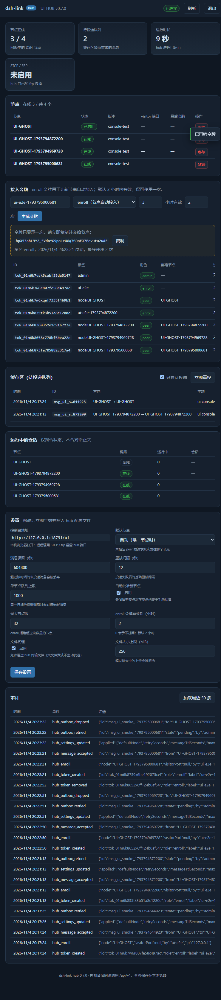

# Hub Web 控制台（0.8）

> 适用：dsh-link **hub 进程**（\`dshlink hub serve\`）。节点（8787）和网关（8788）没有这个页面。
> 相关：[HUB-TOPOLOGY-DESIGN.md](HUB-TOPOLOGY-DESIGN.md)（拓扑设计）、[GATEWAY.md](GATEWAY.md)（节点网关）、[OPERATIONS.md](OPERATIONS.md)（常驻与巡检）。

## 0. 摘要

0.8 起 hub 自带一个**单页 Web 控制台**，用来完成日常运维里最常做的四件事，不必再开终端：

- 生成 / 吊销**接入令牌**（enroll token，交给新节点执行 \`dshlink hub enroll\`）；
- 看一眼**状态监控**：节点在线数、待投递队列、运行时长、STCP/FRP 是否启用；
- 查看并处理**缓存区**（hub outbox）：立即重投、单条重投、丢弃；
- 管理**其他 hub 设置**：重试间隔、消息 TTL、每目标队列上限、准入策略与文件上限等（写回 hub 配置文件，多数立即生效）。

实现是零依赖的单个 HTML 文件（\`src/hubui.mjs\`），由 hub 进程在 \`/ui\` 直接吐出；页面本身不含任何秘密，所有数据都通过同源 \`/api/v1/hub/*\` 拉取，每个请求都要求 **admin** 令牌——hub 从不像节点那样信任回环地址。

## 1. 打开与登录

\`\`\`
http://<hub 地址>:<hub 端口>/ui        # 直接打开控制台
http://<hub 地址>:<hub 端口>/          # 302 -> /ui（方便记地址）
\`\`\`

- 登录框粘贴 **admin 令牌**（\`dshlink hub init\` 的输出，或 \`dshlink hub token new --role admin\` 新签发的令牌）。
- 令牌保存在该浏览器的 \`localStorage\`（键 \`dshlink-hub-token\`），只在同源请求里作为 \`Authorization: Bearer\` 发送；「退出」会清除它。
- 页面每 5 秒轮询一次；浏览器标签页切到后台时自动暂停，切回来立即刷新一次。
- 用的浏览器要能访问 hub 端口：同一局域网、WireGuard/Tailscale，或经 FRP visitor 转发到本机回环端口。**不要**把 hub 明文端口直接暴露到公网（无 TLS；需要公网时请用 FRP/TLS 或 VPN）。

## 2. 界面分区

| 分区 | 能看到 | 能做什么 |
|---|---|---|
| 状态卡 | 在线节点 x/y、网络中节点数、待投递队列、运行时长、STCP/FRP 开关 | 只读 |
| 节点 | 名称、状态（active/pending/offline）、版本、visitor 端口、最近心跳、角色/错误 | 批准 pending 节点、移除节点（带确认） |
| 接入令牌 | 标签、角色、绑定节点、过期时间、最大次数、已用次数 | 生成 enroll/admin/device/peer 令牌（明文只显示一次，可复制）、吊销 |
| 缓存区（outbox） | 每条待下发消息 id、时间、方向、目标、主题、投递状态/错误 | 「只看待投递」过滤、立即重投整队、单条重投、丢弃（标记 dropped，不物理删除） |
| 运行中会话 | 各节点聚合的 Session 运行状态（不返回正文） | 只读 |
| 设置 | 当前 hub 配置（脱敏，无 frp secretKey） | 修改常用项并保存；未知键/越界会被拒绝 |
| 审计 | 最近 50 条 hub 审计事件（令牌、设置、接入、outbox 操作等） | 只读 |

## 3. 令牌角色速查

| 角色 | 用途 | 谁能签 | 备注 |
|---|---|---|---|
| \`admin\` | 管理 hub（CLI + 控制台全部管理 API） | 控制台 / CLI / init | 保存好；等于 hub 的最高权限 |
| \`enroll\` | 一次性接入令牌，交给新节点 enroll | 控制台 / CLI | 默认 2 小时过期、默认只能用 1 次（受 \`enrollment.maxUsesPerToken\` 影响） |
| \`device\` | 手机控制端连 hub | 控制台 / CLI | 只读 DSH / 发能力调用 |
| \`peer\` | 节点上行令牌（enroll 自动签发） | enroll 时自动 | 绑定节点名，禁止冒名 |

控制台生成的令牌**明文只显示一次**；列表接口永远只返回元数据（无 hash、无明文）。吊销立即生效（写回配置并删记录）。

## 4. 设置项（\`PATCH /api/v1/hub/settings\` 白名单）

| 键 | 范围 | 作用 |
|---|---|---|
| \`defaultNode\` | 空 / 已登记节点名 | 未指定 \`peer\` 时的默认节点 |
| \`messageTtlSeconds\` | 60 – 7776000 | 消息在队列里的最长存活时间 |
| \`retrySeconds\` | 1 – 3600 | 投递失败重试间隔 |
| \`maxPendingPerTarget\` | 1 – 100000 | 每个目标节点最多积压多少条 |
| \`heartbeatSeconds\` | 5 – 3600 | 节点心跳间隔 |
| \`offlineAfterSeconds\` | 10 – 86400 | 多久没心跳算离线 |
| \`enrollment.enabled\` | 布尔 | 是否允许 enroll |
| \`enrollment.autoApprove\` | 布尔 | 新节点是否免审批直接 active |
| \`enrollment.maxNodes\` | 1 – 500 | 登记节点上限 |
| \`enrollment.maxUsesPerToken\` | 1 – 10000 | 新 enroll 令牌默认可用次数 |
| \`enrollment.rateLimitPerMinute\` | 1 – 600 | enroll/heartbeat 限速 |
| \`enrollment.tokenTtlHours\` | 1 – 720 | 新 enroll 令牌默认有效期（小时） |
| \`files.enabled\` | 布尔 | hub 文件代理开关 |
| \`files.maxBytes\` | 1 – 4 GiB | 单文件上限 |
| \`files.maxConcurrent\` | 1 – 32 | 并发文件传输上限 |

规则：未知键 → \`400 unknown setting: X\`；越界 → \`400\`；本次没有任何可应用的变更 → \`400\`。保存后立即更新运行中的 hub 配置并写回 \`dshlink-hub.config.json\`；\`bind\`/\`port\`/\`frp\` 这类需要重启的项**不在**白名单里。

## 5. 控制台用的 admin API

所有端点都要求 \`Authorization: Bearer <admin token>\`；hub 不信任回环地址。

| 方法 | 路径 | 作用 |
|---|---|---|
| GET | \`/ui\`（匿名） | 控制台页面（登录页，无数据、无令牌） |
| GET | \`/\`（匿名） | 302 → \`/ui\` |
| GET | \`/api/v1/hub/config\` | hub 身份 + 当前设置 + \`console.url\`（脱敏） |
| PATCH | \`/api/v1/hub/settings\` | 修改第 4 节白名单设置 |
| GET | \`/api/v1/hub/tokens\` | 令牌列表（仅元数据） |
| POST | \`/api/v1/hub/tokens\` | 生成令牌：\`{role,label?,ttlHours?,maxUses?,peer?}\` → \`201 {token,entry}\` |
| DELETE | \`/api/v1/hub/tokens/:id\` | 吊销令牌 |
| POST | \`/api/v1/hub/flush\` | 立即重投整队 → \`{attempted}\` |
| POST | \`/api/v1/hub/outbox/:id/retry\` | 单条重投 → \`{id,delivery}\` |
| DELETE | \`/api/v1/hub/outbox/:id\` | 丢弃单条 → \`delivery.state='dropped'\` |
| GET | \`/api/v1/hub/sessions/running\` | 聚合运行中会话（admin/device） |
| GET | \`/api/v1/hub/status\` / \`/nodes\` / \`/outbox\` / \`/api/v1/audit\` | 与 CLI 共用的只读视图 |

示例（不经过页面也能做同样的事）：

\`\`\`bash
HUB=http://127.0.0.1:18790
ADMIN=<admin token>

# 生成一个 2 小时、可用 1 次的 enroll 令牌
curl -s -X POST "$HUB/api/v1/hub/tokens" \
  -H "Authorization: Bearer $ADMIN" -H 'content-type: application/json' \
  -d '{"role":"enroll","label":"laptop-3"}'

# 看队列并重投整队
curl -s "$HUB/api/v1/hub/outbox?pending=1&limit=20" -H "Authorization: Bearer $ADMIN"
curl -s -X POST "$HUB/api/v1/hub/flush" -H "Authorization: Bearer $ADMIN"

# 改重试间隔（立即生效并写回配置）
curl -s -X PATCH "$HUB/api/v1/hub/settings" \
  -H "Authorization: Bearer $ADMIN" -H 'content-type: application/json' \
  -d '{"retrySeconds":15}'
\`\`\`

## 6. 安全设计

- **登录页无数据**：\`/ui\` 不需要令牌即可拿到，但 HTML 里没有任何 hub 数据/令牌，只有表单和脚本；接口一律要 admin 令牌。
- **CSP 收紧**：\`default-src 'self'\`、\`script-src 'unsafe-inline'\`（单文件内联脚本）、\`connect-src 'self'\`、\`frame-ancestors 'none'\`、\`base-uri 'none'\`、\`form-action 'none'\`；页面无第三方资源（favicon 也是内联 data URI），不请求外网。
- **不泄露秘密**：列表/配置接口不返回令牌明文与 hash，也不返回 frp \`secretKey\`。
- **写操作全部走 admin API**：控制台只是调用与 CLI 相同的端点，没有隐藏后门；每个写操作都写 \`audit.jsonl\`（\`hub_token_created\`/\`hub_token_removed\`/\`hub_settings_updated\`/\`hub_outbox_dropped\` 等）。
- **浏览器侧注意**：令牌存在 \`localStorage\`，共享电脑上记得「退出」；hub 本身不做 TLS 终结，公网访问请套 FRP/TLS 或 VPN。
- **与节点 bridge 设置面板的关系**：DSH 里的 bridge 插件面板（Settings → dsh-link）只读**节点自己**的 hub 快照（\`state.json.hub\`），不做管理操作；管理操作只在这个 hub 控制台或 CLI 里做。

## 7. 验证记录

2026-11-04 用无头 Edge（\`msedge --headless=new --remote-debugging-port=9333\`）+ CDP 对一个临时 hub（\`dshlink hub init --name UI-HUB --port 18791\`）跑了 18 项端到端断言，全部通过：

登录页渲染与版本号、登录、4 张状态卡、令牌列表（admin 行、无秘密）、设置表单、生成 enroll 令牌（明文一次、\`maxUses=2\`）、用页面令牌 enroll 假节点、造一条 pending outbox、outbox 表可见、改 \`retrySeconds\` 保存并落库、控制台重投（\`state=pending\` 且带 \`cannot reach hub->…\` 错误）、控制台丢弃（\`state=dropped\`，确认框文案断言）、审计面板出现 \`hub_token_created\`、吊销令牌（确认框 + 列表消失）、截图、退出登录清除 localStorage、**零 JS 异常 / 零 console error / 零 4xx-5xx 资源请求**。

回归测试：\`test/hub.test.mjs\` 的 \`hub: web console serves the UI and its admin APIs\` 覆盖页面/CSP/鉴权/令牌/设置/outbox 接口；全量见 README 的测试计数。

## 8. 排障

| 症状 | 原因 | 处理 |
|---|---|---|
| 打开 \`/ui\` 404 | hub 版本 < 0.8，或打开的是节点端口 | 升级 hub；节点没有 \`/ui\` |
| 登录一直 401 | 不是 admin 令牌 / 令牌过期/被吊销 | 用 \`dshlink hub token new --role admin\` 重新签发 |
| 页面能开但数据空白 | 浏览器到 hub 端口被拦 / 反代丢了 \`Authorization\` | 直连 hub 端口或检查反代；控制台必须同源调用 |
| 保存设置 400 \`unknown setting\` | 键名不在白名单（第 4 节） | 用白名单键；\`bind/port/frp\` 改配置文件并重启 |
| 重投后仍 pending | 目标节点未 enroll / 离线 / URL 不可达 | 看 \`delivery.error\`；先修节点连通与 enroll |
| 页面输入框被浏览器弹窗卡住 | 移除/丢弃/吊销会弹 \`confirm\`（预期） | 确认后继续；自动化测试里需处理 JS 对话框 |
