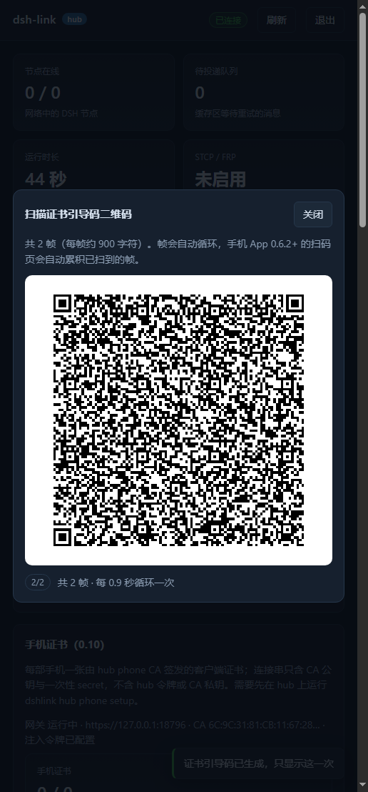

# 二维码连接串（0.11.0）

目标：hub Web 控制台把 dshlink2 / dshlink1 连接串显示成二维码，手机控制端（Android 0.6.2+）
用相机连续扫描或一次选多张二维码图片，拼回完整连接串后导入。这样不需要用户手工复制
7 KB 的文本，也不需要把连接串发到聊天软件里。

## 1. 为什么是多帧

真机 dshlink2 连接串约 7.2 KB，包含 CA 公钥、引导码、可选的 STCP 隧道 frpc 配置与证书。
QR 码单码上限（版本 40、ECC L、byte 模式）只有 2953 字节，一屏装不下。因此把连接串切成
多块，每块一个二维码，界面循环播放（动态二维码）；手机端连续扫，或者把每帧截图/图片一起
选中后离屏拼装。

## 2. 帧文本格式

~~~text
dshlinkqr:<index>/<total>:<chunk>
~~~

- 前缀固定为 dshlinkqr。
- index 从 1 开始，total 为总帧数（1..32）。
- chunk 是原连接串的一个子串；各帧 chunk 按 index 升序直接拼接即为原串（不插入分隔符）。
- 连接串是 ASCII（dshlink1:/dshlink2: + base64url / JSON 的 base64url），chunk 边界按字符切，
  不会拆坏多字节字符。
- 示例（2 帧）：dshlinkqr:1/2:dshlink2:AAAA... 与 dshlinkqr:2/2:...ZZZZ

默认 chunk 900 字符：7.2 KB 的码切成 8 帧，帧文本约 920 字节，QR 版本约 24（约 111x111
模块），手机 1080p 屏可扫。chunk 可配 200..2400；2400 时帧文本约 2.4 KB，仍在版本 40-L 内。

## 3. 服务端编码（hub）

~~~http
POST /api/v1/hub/phone/qr        (admin token)
body: { "code": "<connect code>", "chunkSize": 900 }   // chunkSize 可选
~~~

~~~json
200: {
  "total": 8,
  "chunkSize": 900,
  "codeBytes": 7168,
  "frames": [
    { "index": 1, "total": 8, "payload": "dshlinkqr:1/8:...", "size": 111, "rows": ["0101...", "..."] }
  ]
}
~~~

- 校验：code 必须是字符串，长度 16..100000；chunkSize 缺省 900，范围 200..2400。
- rows 为 QR 矩阵的每行，字符 0/1；size 为矩阵边长（模块数，不含静区）。
- hub 使用 Nayuki qrcodegen（MIT，vendor/qrcodegen，服务端 Node 模块），ECC 级别 LOW、
  boostEcl=true、maxVersion=40。
- 该端点只返回矩阵，不返回 PNG/SVG，尽量减小响应（一行 rows 比 base64 PNG 小）。
- 不需要 CA / phone gateway；纯文本转换，但必须是 admin token（连接串含一次性 secret）。
- 审计只记录事件 hub_phone_qr 的 frames/codeBytes，不记录连接串内容。

## 4. hub 控制台行为

- 手机证书（0.10）卡片生成 dshlink2 引导码后，多出「显示二维码」按钮（id pvQr）；旧版手机
  接入（dshlink1）卡片的「显示二维码」按钮（id phoneQr）走同一套帧格式。
- 点击后请求上面的端点，在覆盖层（#qrModal）的 canvas 上循环画帧，约 900ms 一帧；底部 chip
  显示 i/N，旁边文案为「共 N 帧 · 每 0.9 秒循环一次」。
- 关闭按钮、Escape 或重新生成连接串都会停止定时器并清空动画；页面隐藏（document.hidden）
  时不重绘（定时器仍在，但不会触发网络请求）。
- 不把连接串写进 localStorage；二维码仅存在于当前 DOM/canvas。
- 连接串本身仍是凭据：控制台提示用户不要录屏/截图分享；引导码一次性、默认 2 小时过期。

## 5. 手机端行为

- 相机扫描（ScanActivity）：Camera1 预览 + ZXing MultiFormatReader（仅 QR），对焦/连续解码
  节流约 150ms；识别到帧文本后交给 QrAssembler，状态栏显示「已扫描 x/y 帧」；收齐后把完整
  连接串回传主界面，沿用现有的 importText(code, "扫描的二维码") 流程。
- 图片导入：主界面「从文件导入」支持一次选择多张二维码截图（PNG/JPEG/WebP），逐张 ZXing
  解码，同样用 QrAssembler 拼装；也继续支持 .txt/.json 连接串文件。
- 帧可以乱序到达，也可重复扫描；total 不一致时重置并提示重新开始。
- 拼装完成后先做 ConnectProfile 的既有校验（dshlink1:/dshlink2: 前缀、字段完整性），
  再走导入与连接流程；不因为二维码绕过任何校验。
- 相机权限被拒绝时给出可操作提示（去系统设置授权），不崩溃；没有相机的设备仍可用图片导入。

### 5.1 解码器必须重试（实测坑）

ZXing 的 detector 会在一张**完全合法、像素完美**的二维码上抛 NotFoundException：payload 与
mask 组合出的局部图案在特定方向被误判成 finder pattern。实测（12 个 914 字符 payload × 8 种
mask，以及真实 7 KB 码的首帧）：

- 同一矩阵 plain 解码失败，而 PURE_BARCODE 成功；旋转 90/180/270 度后 plain 成功。
- 缩放（8/12/16/20 倍）、静区（4/8/12 模块）、两种 binarizer 都不能让失败变体在 base 方向成功。
- 因此解码必须「4 个方向 × 3 种 hint（plain / TRY_HARDER / TRY_HARDER+PURE_BARCODE）」重试；
  相机路径上 PURE 常因透视失败，旋转重试更重要。
- 测试解码器在任一帧最终失败时输出 FAILED 行，test/qr.test.mjs 断言没有 FAILED，避免静默跳过。

## 6. 安全边界

- 二维码内容 = 完整连接串 = 凭据。dshlink2 引导码一次性（兑换证书后 secret 清零），dshlink1
  含 device token；带隧道的码还含 STCP visitor secretKey 与客户端证书。任何拿到二维码的人
  都能在有效期内接入，因此：控制台只对 admin 展示；默认 TTL 2 小时；扫描后尽快兑换。
- 帧文本不带 hub URL、token 之外的额外元数据；服务端不记录帧内容（只记审计事件
  hub_phone_qr 的 total/size，不含 code）。
- 手机端不把连接串写入日志；导入成功后按既有逻辑保存 profile（App 私有目录）并清引导码 secret。

## 7. 工具与测试

- scripts/qrgen.mjs：把连接串（文件或 stdin）生成 frame-XX.png 与 manifest.json，供模拟器
  导入测试、文档截图与离线排障。
- test/qr.test.mjs（5 个测试）：纯函数测试帧切分/拼装/校验；用 ZXing Java 解码生成的 PNG，
  做真实 roundtrip（7 KB 真机码 8 帧全部解码并拼回原串），含上述多方向/多 hint 重试。
- test/hub.test.mjs：/api/v1/hub/phone/qr 的鉴权（admin 200 / device 403）、帧数、帧字段
  （size/rows/payload）、坏 code 400，以及 /ui 页面含 #qrModal / pvQr / phoneQr。
- 浏览器 e2e（无头 Edge + CDP）：登录 → 生成 dshlink2 引导码（1691 字符，2 帧）→ 打开二维码
  → canvas 436x436 有内容且帧自动前进 → 关闭后停止 → 旧版 dshlink1 码（1 帧）同样渲染 →
  重新生成时旧覆盖层关闭 → 零 JS 异常；14/14 断言通过。
- Android 0.6.2（`dshlink-control-0.6.2-debug.apk`，versionCode 9，通用构建无 `assets/`）：
  `QrAssembler` 38/38、`QrImages` 31/31 桌面冒烟（含倒置、50% 缩放、相机 Y 平面、噪声）；
  模拟器把 8 帧真实 dshlink2 码多选图片导入后拼回 7,171 字符，对话框显示“来源：二维码图片（8 帧）”，
  随后 bootstrap + mTLS 连接成功；相机扫码的拒绝/允许/释放三条路径均无崩溃（模拟器虚拟相机无
  真实二维码场景，真机扫码路径尚未验证，见 `docs/mobile/CONTROL-APP.md` §4）。

## 8. 第三方

- vendor/qrcodegen/qrcodegen.mjs：Project Nayuki QR Code generator，MIT；只追加一行 ESM
  export，MIT 版权头保留在文件顶部。
- vendor/zxing/zxing-core-3.5.3.jar：ZXing core，Apache-2.0；字节未改，Android 构建时加入
  javac classpath 与 d8；测试用同一 jar 编译一个小解码器验证帧可被真实解码。
